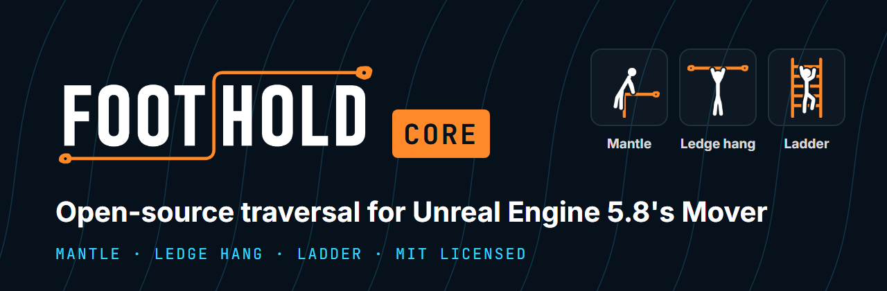
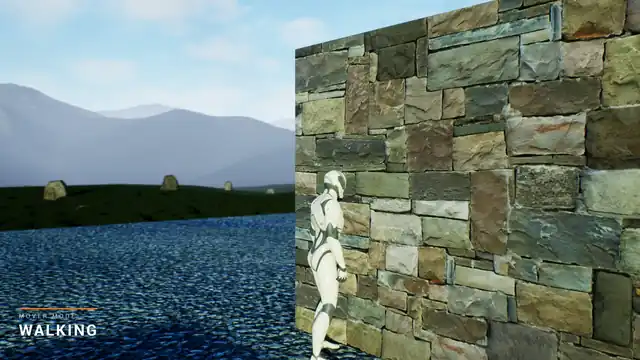
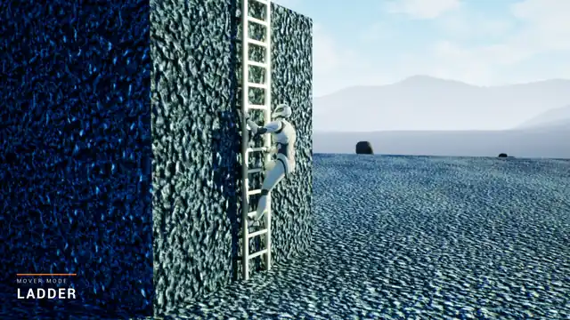
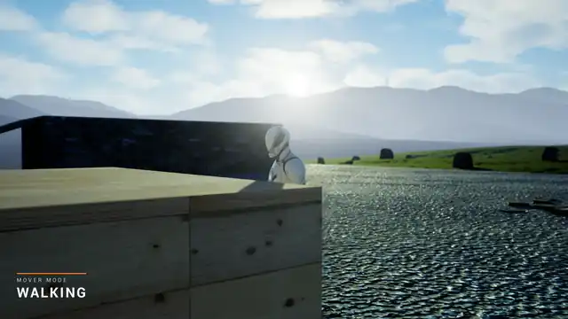
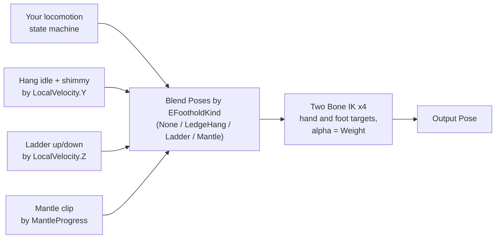
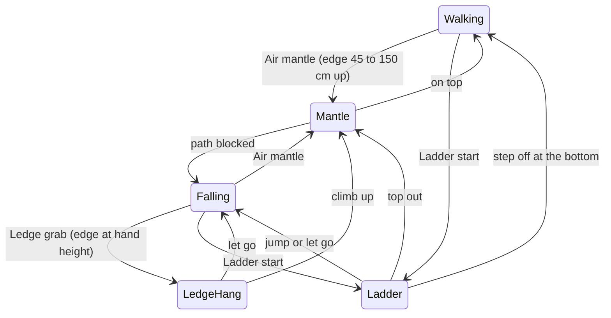
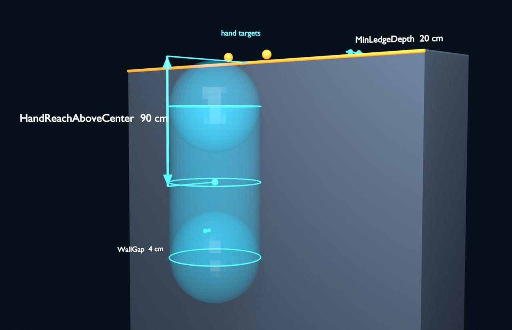
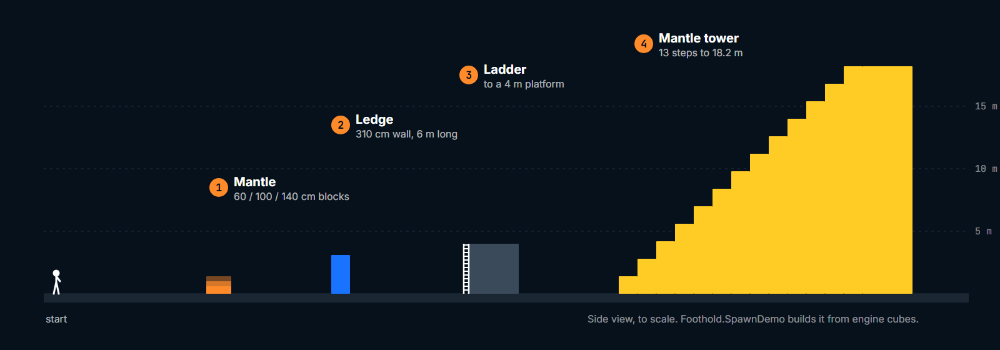
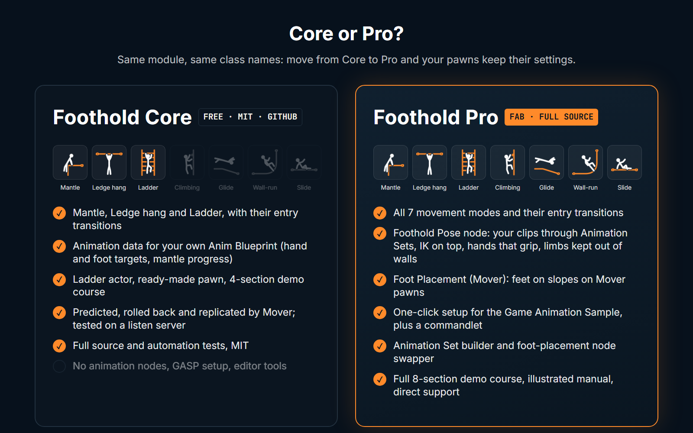
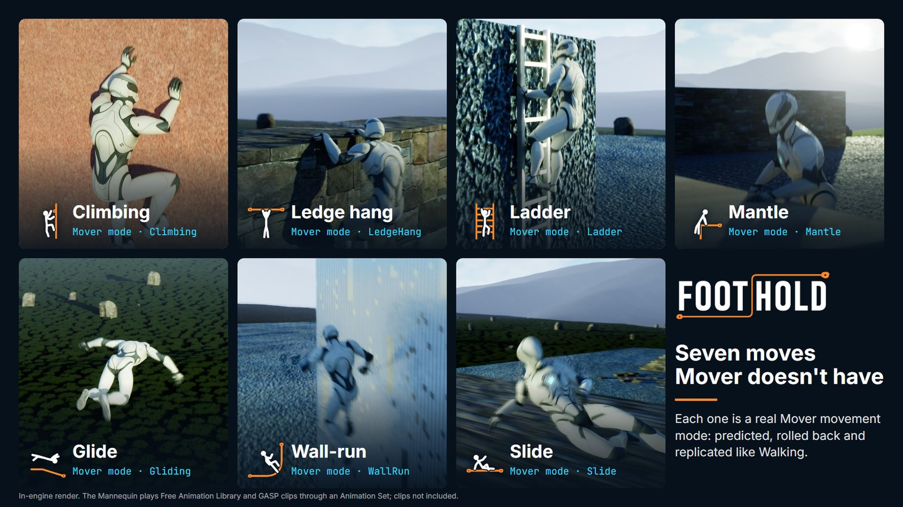

<div align="center">



[](LICENSE)
[](https://www.unrealengine.com/)
[](https://dev.epicgames.com/documentation/en-us/unreal-engine/mover-in-unreal-engine)
[](#install)
[](Source/Foothold)
[](#tests)
[](https://github.com/gregorik/Foothold-Core/releases)
[](https://www.fab.com/sellers/GregOrigin)
[](https://github.com/gregorik/Foothold-Core/stargazers)

**Mantle, ledge hang and ladders for Unreal Engine 5.8's Mover, as real movement modes.**<br>
**Predicted, rolled back and replicated like Walking. MIT-licensed. Drop it into `Plugins/`.**

</div>

---

Epic's Mover plugin walks, falls, flies and swims. Jump at a ledge and your character slides straight down the wall.
There's no mantle, no hang, no ladder, and the Character Movement Component tricks people used for those don't carry
over, because Mover runs its own simulation.

Foothold Core adds three of the moves that are missing, written the way Mover expects: each one is a movement mode,
entered by a global transition, with its state in Mover's sync state. That means it predicts on the client, rolls
back on a correction and replicates without any extra networking code from you. A client that gets corrected halfway
up a ladder is still on the ladder afterwards.

> **TL;DR.** Put the plugin in `Plugins/FootholdCore`, give your pawn a `UFootholdMoverComponent` and a
> `UFootholdComponent`, and jump at a wall. Read `UFootholdComponent::GetAnimData()` in your Anim Blueprint to play
> your own hang, ladder and mantle clips. Type `Foothold.SpawnDemo` to get a course to try it on.

<table>
<tr>
<td width="33%"></td>
<td width="33%"></td>
<td width="33%"></td>
</tr>
<tr>
<td align="center"><b>Ledge hang</b> → climb up</td>
<td align="center"><b>Ladder</b> → mantle off the top</td>
<td align="center"><b>Mantle</b> from a jump</td>
</tr>
</table>

<sub>In-engine renders. The movement and the <code>MOVER MODE</code> readout are exactly what Core does. The character's
pose comes from Foothold Pro's Foothold Pose node playing Free Animation Library clips; in Core you animate it yourself
from the animation data (see <a href="#animating-it">Animating it</a>).</sub>

*Need it wired into your project, or Mover itself? I take on Unreal C++ work: [get in touch](https://gregorigin.com/contact.html).*

## Contents

- [What's in Core](#whats-in-core)
- [Install](#install)
- [Quick start](#quick-start)
- [Animating it](#animating-it)
- [How it works](#how-it-works)
- [Settings](#settings)
- [The demo course](#the-demo-course)
- [Debugging](#debugging)
- [Tests](#tests)
- [**Core vs Pro**](#core-vs-pro)
- [Limitations](#limitations)
- [FAQ](#faq)
- [License](#license)

## What's in Core

| Mode | How it starts | While in it | How it ends |
|---|---|---|---|
| **Mantle** | Jump at an edge 45 to 150 cm above your feet while pushing toward it. From a standing jump that's ledges up to about 2.8 m. Ladders that end in a ledge mantle too. | Automatic: pull up, then move over the top. | Hands over to Walking on top. If the path gets blocked, it drops to Falling. |
| **Ledge hang** | Fall or jump near an edge at hand height while facing it. | Move sideways to shimmy along the edge. | Jump, or hold toward the wall for 0.35 s, to climb up. Let go to drop. |
| **Ladder** | Walk into a ladder, or touch one in the air. | Forward climbs up, back climbs down; you stop on the nearest rung. | At the top you mantle off; at the bottom you step off. Jump or let go to jump off. |

"Let go" means any of: `UFootholdComponent::RequestDrop()`, holding crouch (`SetCrouchHeld(true)`), or jumping while
pushing away from the surface.

Also in the box:

- **`UFootholdMoverComponent`**: Mover's character component with the three modes and their transitions already added.
- **`UFootholdComponent`**: the extra inputs (drop, crouch), the **animation data** your Anim Blueprint reads, an
  `OnFootholdModeChanged` event and optional entry montages.
- **`AFootholdLadder`** and **`UFootholdLadderComponent`**: a ready ladder, or ladder behaviour on your own mesh.
  Ladders replicate, so ones you spawn at runtime work in multiplayer too.
- **`AFootholdCharacter`**: a ready-made pawn (capsule, mesh, camera, Mover, Enhanced Input).
- **`AFootholdDemoCourse`**: a course with a section for each move, built from engine cubes.
- **48 automation tests**, and the full C++ source. No Blueprints, no content, no external dependencies beyond Mover and
  Enhanced Input.

## Install

You need **Unreal Engine 5.8** and a C++ project (or the prebuilt binaries from the release, below).

```bash
cd YourProject/Plugins
git clone https://github.com/gregorik/Foothold-Core.git FootholdCore
```

Then regenerate project files, build, and enable **Foothold Core** in Edit > Plugins. Mover and Enhanced Input are
enabled with it. If you'd rather not compile, the [v0.1 release](https://github.com/gregorik/Foothold-Core/releases)
has a Win64 zip with the editor binaries built against UE 5.8.3: unzip it into `Plugins/` and open the project. On
another 5.8 patch, Unreal will offer to rebuild them, which needs a C++ toolchain.

I've verified it on Windows. The code has nothing platform-specific in it, so Linux and Mac should build, but I
haven't run them.

## Quick start

### 1. Give your pawn the components

**From C++**, use `UFootholdMoverComponent` where you'd use `UCharacterMoverComponent`, and add a `UFootholdComponent`:

```cpp
#include "FootholdMoverComponent.h"
#include "FootholdComponent.h"

AMyPawn::AMyPawn()
{
	Mover = CreateDefaultSubobject<UFootholdMoverComponent>(TEXT("Mover"));	// Mantle, LedgeHang and Ladder included
	Foothold = CreateDefaultSubobject<UFootholdComponent>(TEXT("Foothold"));
}
```

Your pawn still produces Mover input the usual way (`IMoverInputProducerInterface`); `AFootholdCharacter` shows how.
Already have a Mover component you don't want to replace? `FFootholdDefaults::AddToMover(*Mover)` adds the modes and
transitions to it at runtime.

**From Blueprint**, the quickest way is `AFootholdCharacter`: make a Blueprint child, then set its Mesh, Anim Class,
Input Mapping Context and the Move, Look and Jump actions.

### 2. Put something to climb in the level

Ledges need nothing: any wall whose top is at least 20 cm deep can be grabbed. Ladders are an `AFootholdLadder` (rails
and rungs built for you), or a `UFootholdLadderComponent` on your own mesh. The ladder's +X axis faces the climber.

### 3. Try it

Press Play and type `Foothold.SpawnDemo` in the console. A course appears 5 m in front of you and you're moved to its
start. `foothold.Debug 1` draws every probe.

## Animating it

Core moves the capsule. What the mesh does is up to your Anim Blueprint, and `UFootholdComponent::GetAnimData()` gives
it everything it needs. It's thread-safe, so call it from `BlueprintThreadSafeUpdateAnimation`.

| Field | What it tells you |
|---|---|
| `Kind`, `Weight` | Which Foothold mode is running (`EFootholdKind`, `None` otherwise) and a 0 to 1 blend weight that eases in and out. |
| `LocalVelocity` | Velocity in the character's space: shimmy and ladder direction and speed. |
| `SurfaceNormal`, `SurfacePoint`, `Facing`, `Up` | The wall or ladder you're on. |
| `LeftHandTarget` … `RightFootTarget` + `b…Valid` | World-space hand and foot targets on the ledge, wall or rungs. Feed them to Two Bone IK. |
| `LimbLift`, `CycleDistance` | How far each limb is lifted on its way to the next hold, and the stride, for syncing clips. |
| `MantleAlpha`, `MantleRiseShare`, `MantleTravel`, `MantleProgress` | Where the mantle is: drive a mantle clip by progress instead of time. |
| `ReachWeight`, `LeftReachTarget`, `RightReachTarget` | Arms reaching for a ledge before the catch. |
| `TimeInMode` | Seconds since the mode started. |

A setup that works well:



`OnFootholdModeChanged(PreviousKind, NewKind)` fires when a mode starts or ends, and `EntryMontages` maps a kind to a
montage that plays when that mode starts: handy for a one-shot catch or a ladder mount.

If you'd rather not build this yourself, it's what [Foothold Pro](#core-vs-pro) does for you: its Foothold Pose node
plays your clips from an Animation Set (blended by direction, matched to speed, held on the capsule) with IK, gripping
hands and wall clearance on top, or a procedural pose when you have no clips.

## How it works



A few rules hold it together:

- **The mode decides; transitions only enter.** A transition finds the ledge or ladder and hands it to the mode
  through Mover's simulation blackboard, stamped with the sim time. The mode re-checks everything each tick.
- **The air mantle is checked before the ledge grab**, so a ledge you can jump onto gets a mantle and a higher one
  gets a hang.
- **All Foothold state is one sync struct**, `FFootholdSyncState`. It serializes only the fields the current mode
  uses and reconciles at 2 cm. Inputs travel in `FFootholdInputs`, and button presses survive Mover's input merging.

This movement code is the same as Foothold Pro's, and I tested it there: with a listen server, and with packaged
Linux dedicated servers in Development and Shipping serving packaged Windows and Android clients, the client driving a
course through scripted input. In every run the server saw the same mode changes, in the same order, as the client,
including with lag, packet loss, duplicates and reordering added (by Unreal's packet emulation, and separately by
Linux's network emulation on the server), and with a phone joining over Wi-Fi. The exception was a 15 fps phone with
loss added, where Network Prediction's default input settings sometimes dropped a jump press. The numbers, and the
setting that fixed it, are under [Tests](#packaged-builds-dedicated-servers-and-bad-networks).

Two UE 5.8 engine issues showed up, both reproduced with Mover's own `UCharacterMoverComponent` pawn and no Foothold
code:
- **A Shipping client crashes when it joins a server from a level that has a Mover pawn**, in Mover's teardown of that
  pawn (`UKinematicActorSimulation::BeginDestroy`). Join from a level without one, such as a menu, and it doesn't.
- **Development and Shipping builds can't play together over Mover** (Network Prediction adds debug checksums outside
  Shipping). Ship server and client in the same configuration.

## Settings

Everything is on the mode or transition objects inside the Mover component (Details panel > Movement Modes /
Transitions), so you can tune per pawn. Speeds are in cm/s.



<sub>The ledge hang's shared settings at their defaults: hand targets on the edge `HandReachAboveCenter` (90 cm) above
the capsule's centre, `WallGap` (4 cm) between capsule and wall, and a top at least `MinLedgeDepth` (20 cm) deep.
Rendered in Blender.</sub>

**Shared settings** (`UFootholdSharedSettings`, on the Mover component)

| Setting | Default | What it does |
|---|---|---|
| TraceChannel | Visibility | Channel for every Foothold probe. |
| NoClimbTag | `NoClimb` | Component or actor tag that blocks ledge grabs and mantles. |
| MinWallAngle | 70° | A surface counts as a wall at this angle from up or more. |
| HandReachAboveCenter | 90 cm | Where the hands are above the capsule centre while hanging. |
| WallGap | 4 cm | Gap between the capsule and the wall while hanging. |
| MinLedgeDepth | 20 cm | A ledge top must be at least this deep. |
| bAllowHangOnUnstandableLedges | false | Allow hanging from tops too steep to stand on (no climb-up there). |
| MaxWalkSlopeCosine | 0.71 (45°) | Walkable slope for ledge tops and landings. |
| bDrawDebug | false | Draw probes and anchors (same as `foothold.Debug 1`). |

**Modes**

| Mode | Settings (defaults) |
|---|---|
| Mantle | RiseSpeed 260, OverSpeed 300, MinPhaseDuration 0.18 s, MaxDuration 1.2 s, MaxHeight 260 cm, ExitSpeed 150, BlockedTolerance 10 cm, RetryCooldown 0.25 s |
| Ledge hang | ShimmySpeed 130, SettleTime 0.15 s, ClimbUpHoldTime 0.35 s, DropPushSpeed 150, RegrabDelay 0.4 s, MaxEdgeStep 20 cm, EdgeSearchMargin 35 cm |
| Ladder | ClimbSpeed 150, RungSettleSpeed 60, EntryTime 0.2 s, JumpOffSpeed 300, JumpOffUpSpeed 250, RegrabDelay 0.4 s, GrabDistance 80 cm, FloorStepOffDistance 6 cm, TopOutBelowTop 60 cm |

**Entry transitions** (global, on the Mover component, checked in this order)

| Transition | Settings (defaults) |
|---|---|
| Air mantle | MinHeight 45 cm, MaxHeight 150 cm, Reach 35 cm, MaxUpSpeed 450, MinInputTowardWall 0.5 |
| Ledge grab | BelowReach 35 cm, AboveReach 25 cm, Reach 30 cm, MaxUpSpeed 150, MinTowardWall 0.5 |
| Ladder start | GroundReach 60 cm, AirReach 50 cm, MinTowardLadder 0.5 |

**Ladders** (`UFootholdLadderComponent`): Height 400 cm, Width 60 cm, RungSpacing 30 cm, StandOffDistance 45 cm,
bMantleOffTop true.

Lower the Air mantle's `MaxHeight` to make more ledges hang-only. If your mantle clips look rushed, give the Mantle
mode a slower `RiseSpeed` and `OverSpeed` and a longer `MaxDuration`.

## The demo course



`Foothold.SpawnDemo` spawns it 5 m in front of you (or `Foothold.SpawnDemo X Y Z` at a point) and moves you to the
start. You can also drop **Foothold Demo Course** into a level. Four sections, all to the scale above:

1. **Mantle**: blocks of 60, 100 and 140 cm.
2. **Ledge**: a 310 cm wall, too tall to jump onto, 6 m long to shimmy along.
3. **Ladder**: up to a 4 m platform, mantling off the top.
4. **Mantle tower**: 13 steps of 140 cm to an 18 m top. In Foothold Pro you glide off it.

The course replicates, so one spawned on the server shows up on every client. In a networked game, run the command
on the server (`ServerExec Foothold.SpawnDemo`). `GetSectionStart(Name)` returns where to stand for each section.

## Debugging

| Command | What it does |
|---|---|
| `Foothold.SpawnDemo [X Y Z]` | Spawns the demo course and moves you to its start. |
| `foothold.Debug 1` | Draws every probe, ledge and anchor. |
| `log LogFoothold Verbose` | Logs every mode change as `[NetMode/Role] Pawn Old -> New @frame N`. |

## Tests

48 automation tests ship with the source, under `Source/Foothold/Private/Tests`: each mode's entries, exits and edge
cases (16), the probes (10), the component and its inputs (7), the sync state's serialization (5), the ladder (3), the
demo course (4), and smoke tests for the pawn and Mover. Run them from **Tools > Test Automation** with the filter
`Foothold`, or from the command line:

```bash
UnrealEditor-Cmd.exe YourProject.uproject -ExecCmds="Automation RunTests Foothold; Quit" -unattended -NullRHI
```

For v0.1.1 they all pass on UE 5.8 (Win64) in a clean, content-free host project, and the plugin also builds with
strict includes (no PCH, no unity).

### Packaged builds, dedicated servers and bad networks

Core's three modes, their transitions, the component and the ladder are the same source files as Foothold Pro's
(synced from it), so I tested them in Pro's dev project: packaged the way a game ships, for Windows, Linux and Android,
in Development and Shipping, with a bot driving it through Pro's 9-section course (it includes Core's mantle, ledge
and ladder sections) and recording every mode change, in Shipping too. That's how the packaged-game bug fixed in
0.1.1 turned up.

**Single player:** sections passed, out of 9.

| Platform | Development | Shipping |
|---|---|---|
| Windows (Win64) | 9/9 | 9/9 |
| Linux | 9/9 | 9/9 |
| Android (x86_64, on the Android 16 emulator, Vulkan) | 9/9 | 9/9 |
| Android phone (arm64): Honor X5c Plus, MediaTek Helio G85, Mali-G52, Android 15; about 15 fps | 9/9 | 9/9 |

**Multiplayer:** one dedicated server and one client. The client's mode changes, as it showed them, match what the
server saw for that pawn, in the same order, and all 9 sections passed, in every run except the two explained below the
table. The phone was a real device on the PC's Wi-Fi.

| Server | Client | Network | Mode changes (client = server) | Client corrections |
|---|---|---|---|---|
| Linux, Development | Windows, Development | clean | 63 = 63 | 11 |
| Linux, Development | Windows, Development | Unreal, average | 63 = 63 | 12 |
| Linux, Development | Windows, Development | Unreal, heavy | 63 = 63 | 11 |
| Linux, Development | Windows, Development | netem | 63 = 63 | 23 |
| Linux, Development | Android, Development | netem + emulator link 40-100 ms | 64 = 64 | not measured |
| Linux, Shipping | Windows, Shipping | clean | 63 = 63 | no log in Shipping |
| Linux, Shipping | Windows, Shipping | netem | 63 = 63 | no log in Shipping |
| Windows editor as server | Windows, Development | clean | 63 = 63 | 11 |
| Windows editor as server | Windows, Development | Unreal, heavy | 63 = 63 | 10 |
| Windows editor as server | Android, Development | clean | 64 = 64 | not measured |
| Windows editor as server | Android, Development | Unreal, heavy + emulator link 60-140 ms | 64 = 64 | not measured |
| Windows editor as server | Android phone, Development | Wi-Fi | 64 = 64 | not measured |
| Windows editor as server | Android phone, Development | Wi-Fi + Unreal, heavy | 61 = 61 | not measured |
| Linux, Development | Android phone, Development | Wi-Fi | 64 = 64 | not measured |
| Linux, Development | Android phone, Development | Wi-Fi + netem | **1 of 3 runs passed**; in the other 2 the server missed one jump press (below) | not measured |
| Linux, Development | Android phone, Development | Wi-Fi + netem, `FixedTickInputSendCount` 16 | 4 of 4 runs passed, 61-64 the same on both sides | not measured |

- **Unreal, average:** Unreal's packet emulation on both ends, 60 ± 15 ms each way, 1% loss.
- **Unreal, heavy:** 150 ± 40 ms each way, 5% loss, 1% duplicates, reordering (about 300 ms round trip).
- **netem:** Linux's network emulation on the server's network card, both ways and below the engine, so it applies
  to Shipping builds too (they have no packet emulation): 80 ± 25 ms each way, 3% loss, 1% duplicates, 5% reordered.
- **Emulator link:** the Android emulator's own network delay, on top of the rest.
- **Wi-Fi:** the phone on the same home Wi-Fi as the PC; the Linux server in WSL was reached through a UDP relay on the
  PC, because WSL's network doesn't take connections from the LAN.

Corrections under netem about doubled. The Linux servers are packaged Server builds; both stayed up after their
client left. The Shipping clients joined from a level without a pawn (see the engine issues under
[How it works](#how-it-works)). Apart from the phone, it all ran on one PC (the Linux server in WSL, the emulator), and
nothing ran over the internet.

**A phone at 15 fps, and Network Prediction's input settings.** The phone ran the game at about 15 fps, so each of
its updates carried about 4 new input frames of Mover's 60 Hz simulation, and Network Prediction's default sends only
the 6 most recent with each update. Over Wi-Fi with netem's loss and reordering on top, the server regularly lacked a
client input frame (35-46 "Gap in input stream" faults a run) or ran out of buffered input (20-30 faults a run). In 2
of 3 runs one of those frames held a jump press: the server didn't jump, so the mantle the client had predicted off
that jump was rolled back a few frames later, and the bot ended that section one step short, on both sides alike.
What was lost was Mover's own jump input; after the rollback every mode change matched the server's again. With
**`FixedTickInputSendCount` raised to 16** (Project Settings > Project > Network Prediction, under Input; server and
client must use the same value) the input gaps went to zero and 4 of 4 runs passed. The input-starvation faults
remained, so a press can still arrive late on a client this slow. If you ship to phones, raise it.

## Core vs Pro



Core is the movement half of Foothold, and it's yours under MIT. **Foothold Pro** is the whole plugin: all seven moves,
the animation layer that makes them look right with your own clips, and one-click setup for the Game Animation Sample.
It's [coming to Fab](https://www.fab.com/sellers/GregOrigin) (GregOrigin's seller page), and its full manual is
already up at [gregorigin.com/Manuals/Foothold](https://gregorigin.com/Manuals/Foothold).

<div align="center">

| | **Foothold Core** (this repo) | **Foothold Pro** (Fab) |
|---|:---:|:---:|
| **Price** | Free | Paid |
| **License** | MIT | Fab EULA |
| **Source** | ✅ Full | ✅ Full |
| **Engine** | UE 5.8 | UE 5.8 |
| **Movement modes** | | |
| Mantle | ✅ | ✅ |
| Ledge hang (shimmy, climb up, drop) | ✅ | ✅ |
| Ladder | ✅ | ✅ |
| Climbing on tagged walls | — | ✅ |
| Glide | — | ✅ |
| Wall-run, with wall jumps that keep your speed | — | ✅ |
| Slide | — | ✅ |
| Predicted, rolled back and replicated by Mover | ✅ | ✅ |
| **Animation** | | |
| Animation data for your own Anim Blueprint | ✅ | ✅ |
| Foothold Pose node: your clips from an Animation Set, with IK on top | — | ✅ |
| Procedural pose for every mode, when you have no clips | — | ✅ |
| Hands that grip the edge, hands and feet kept out of walls | — | ✅ |
| Foot Placement (Mover): feet on slopes on Mover pawns | — | ✅ |
| **Setup and tools** | | |
| `UFootholdMoverComponent`, ready-made pawn, ladder actor | ✅ | ✅ |
| One-click Game Animation Sample setup, plus a commandlet | — | ✅ |
| Animation Set builder from your selected clips | — | ✅ |
| Swap Epic's Foot Placement nodes in one command | — | ✅ |
| Demo course | 4 sections | 8 sections |
| Verified on GASP 5.8 (single player and listen server) | — | ✅ |
| **Docs and support** | | |
| Documentation | This README | [Illustrated manual](https://gregorigin.com/Manuals/Foothold) |
| Support | GitHub Issues | Direct, from me |

</div>



<sub>Foothold Pro: all seven moves, each a Mover mode.</sub>

**Moving from Core to Pro.** Core keeps Pro's module name (`Foothold`) and class names on purpose, so that switching is
meant to be a swap: remove `Plugins/FootholdCore`, add Foothold Pro, and your pawns, Mover components and settings
load as they were, with the four new modes added. That's how it's designed; I haven't run that swap on a large project
yet, so back up first. Don't enable both at once: they share the module name.

## Limitations

- **UE 5.8 only, and Mover is Experimental.** Epic changes Mover's API between versions. I'll keep up, but there's no
  promise for engine versions that don't exist yet.
- **No animation included.** Core moves the capsule and tells you where the hands and feet go; the clips and the Anim
  Blueprint are yours (or Pro's).
- **No getting onto a ladder from its top.** You climb on from the bottom or from the air.
- **Ledge hang can't climb down onto a wall.** That hands over to the Climbing mode, which is in Pro. `ClimbDownHoldTime`
  does nothing without it.
- **Tested** on Win64 here (48 automation tests in a clean project, a strict build), and through Foothold Pro's
  identical movement code in packaged Windows, Linux and Android builds (the emulator and a phone) and on Linux
  dedicated servers, over loopback and over Wi-Fi. Not yet over the internet.

## FAQ

**Does it work with the Character Movement Component?** No. These are Mover movement modes. If you're moving a CMC
character to Mover, `AFootholdCharacter` is a working example of a Mover pawn, and the Pro manual has a checklist.

**Can I use it with the Game Animation Sample?** Yes, by hand: add the modes to `SandboxCharacter_Mover`'s Mover
component (or call `FFootholdDefaults::AddToMover`), map them in GASP's `MovementModeMap` (hang, ladder and mantle to
`OnGround`, so GASP doesn't play a landing after every mantle), and add a `UFootholdComponent`. Foothold Pro does all of
that in one click, with a dry run and backups, and adds the pose node GASP's character needs for hanging and ladders.

**Why are there `Climb`, `Glide`, `WallRun` and `Slide` values in `EFootholdKind`?** Core shares its types with Pro so
that a project can switch between them without losing data. Those values are never entered in Core.

**Is this the same code as Pro?** Yes, for everything Core has: Core is generated from Pro's source, cut down to these
three modes. Fixes to the shared parts go into both.

**Can I use it in a commercial game?** Yes. It's MIT: use it, change it, ship it. Keep the licence notice.

## License

[MIT](LICENSE), © 2026 [GregOrigin](https://www.gregorigin.com). Built by
[Andras Gregori](https://github.com/gregorik) alongside Foothold Pro.

Issues and pull requests are welcome. If you build something with it, I'd love to see it.
